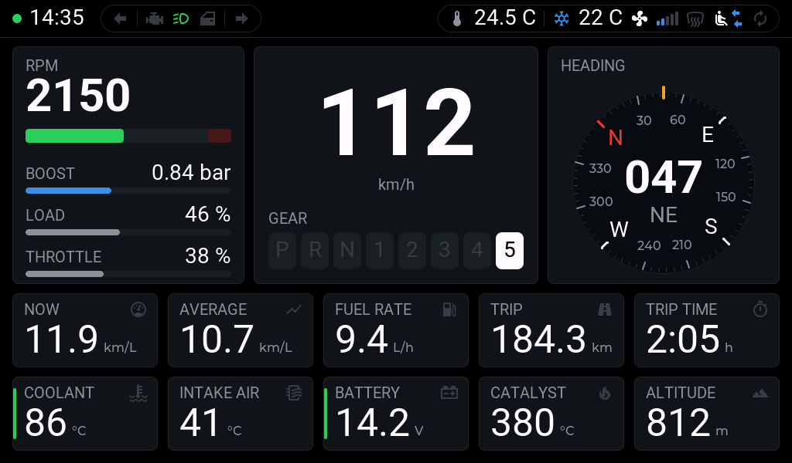
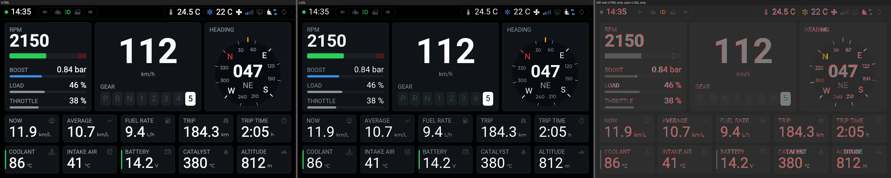

# mitsubishi-pajero-dashboard

Distributed car dashboard built on ESP32. A server node reads vehicle data from
the OBD-II port via CAN bus and broadcasts it wirelessly over ESP-NOW. Client
nodes receive the data and render it on displays using LVGL.

Target vehicle: **Mitsubishi Pajero Dakar 3.2 DI-D** (Pajero Sport II, KH8W,
4M41 diesel) — Brazilian market, 2016/2017. This is the Triton-based
body-on-frame Pajero.




<p align="center"><sub>Main HUD (3.5")</sub></p>

---

## Hardware

| Node | Components |
|---|---|
| Server | ESP32-S3 + MCP2515 CAN controller (OBD-II, 500 kbps) |
| Main display | Waveshare ESP32-S3-Touch-LCD-7B — 7" 1024×600 RGB LCD, GPS, IMU, environment sensors |
| Main HUD | Guition JC3248W535 (ESP32-S3) — 3.5" 320×480 QSPI, windshield-reflected |
| Glass display | Waveshare ESP32-C6-LCD-1.47 — 1.47" 172×320 SPI |
| Simple HUD | CYD (ESP32) — 2.4" 320×240 SPI, LDR auto-brightness |
| Sniffer / Diagnostic | ESP32-S3 + MCP2515 — same board as the server |

---

## Projects

Each sub-project under `projects/` is a standalone PlatformIO environment.

| Project | Role |
|---|---|
| [`server/`](projects/server) | Reads the CAN bus, derives consumption/boost/altitude, broadcasts the `Payload` over ESP-NOW |
| [`server_emulator/`](projects/server_emulator) | Same broadcast from synthetic driving data — client development without the car |
| [`main_display/`](projects/main_display) | 7" LVGL dashboard + GPS/IMU/environment sensors |
| [`main_hud/`](projects/main_hud) | 3.5" QSPI speed display, reflected on the windshield |
| [`glass_display/`](projects/glass_display) | 1.47" ESP32-C6 speed-only client |
| [`client_simple_hud/`](projects/client_simple_hud) | 2.4" CYD HUD with LDR auto-brightness |
| [`sniffer/`](projects/sniffer) | CAN sniffer, DBC files, `monitor.py` and a [live web bus monitor](projects/sniffer/web/README.md) for reverse engineering |
| [`diagnostic/`](projects/diagnostic) | Standalone OBD-II fault scanner — Wi-Fi AP + phone web page ([README](projects/diagnostic/README.md)) |

Shared code lives in `lib/core/` — the `Payload` struct, the PID map, DTC
decoding, the ESP-NOW broadcaster/receiver, and the display/brightness/connection
helpers. Source fonts and images live in `ui/`; `ui/convert_assets.sh` turns them
into the `ui_font_*.c` / `ui_img_*.c` files each client compiles.

---

## Architecture

```
                         ┌──────────── ESP-NOW broadcast, 10 Hz ────────────┐
 OBD-II ── CAN ── Server ┤                                                  │
                         ├──► Main display (7")   ├──► Main HUD (3.5")      │
                         └──► Glass display (1.47") └─► Simple HUD (2.4")   ┘
```

One ESP32 reads OBD-II data over the CAN bus and broadcasts a packed `Payload`
struct at 10 Hz to the ESP-NOW broadcast address. Multiple clients receive and
render it. Communication is unidirectional — there are no ACKs or reverse messages.

**Server data flow**
```
CAN bus → CANDriver → PIDDictionary + PIDTranslator → DataAggregator (mutex)
        → DerivedCalculator → SessionAccumulator → PayloadBuilder → ESPNowBroadcaster
```

**Client data flow**
```
ESP-NOW ISR → ESPNowReceiver → ServerConnectionMonitor + IScreenController → LVGL widgets
```

Session accumulation (distance, average consumption) and every derived value
(instantaneous consumption, fuel rate, boost, altitude) are computed
**server-side** and carried in the `Payload`; clients are pure renderers.

This vehicle answers neither the fuel-rate PID (0x5E) nor any boost PID, so the
server derives fuel rate from the free-running `CAN 0x608` injected-fuel broadcast
(with a MAF-based fallback) and boost from manifold minus barometric pressure.

The `Payload` struct is fixed-size and packed (currently 194 bytes, under
ESP-NOW's 250-byte ceiling); a `static_assert` in `lib/core/include/payload.h`
enforces its exact size at compile time. Use fixed-width integer types only in
its fields — host arm64 and ESP32 sizes differ. Any change to it means bumping
`PAYLOAD_VERSION` and reflashing every node.

---

## Setup

**1. Clone and create the security config**

```bash
git clone git@github.com:fabioseidl/mitsubish-pajero-dashboard.git
cd mitsubish-pajero-dashboard
cp lib/core/include/security_config.h.example \
   lib/core/include/security_config.h
```

Edit `security_config.h` and set a real 16-byte PMK. Every node must carry the
same value. This file is gitignored — never commit it.

**2. Run host tests**

```bash
cd test && pio test -e native_tests
```

All tests must pass before flashing. They use Unity, compile with
`-DUNIT_TEST -std=c++17`, and mock the hardware drivers (CAN, display, ESP-NOW).

**3. Build and flash**

Run from each sub-project directory:

```bash
pio run                    # build only
pio run --target upload    # build and flash to hardware
```

For example:

```bash
cd projects/server        && pio run --target upload
cd projects/main_display  && pio run --target upload
```

Use `server_emulator` instead of `server` when developing without the vehicle.

On Windows PowerShell, skip the `cd` with `pio run -d projects/<name>`. If `pio`
is not on `PATH`, it is at `~/.platformio/penv/bin/pio`.

---

## UI development without hardware

Client screens are designed as an HTML prototype (`sim/prototype.html`), written
by hand in LVGL, and checked against the prototype in a native simulator —
no flashing needed to see a layout change. `main_display`, `main_hud` and
`client_simple_hud` have it.

```bash
# Render every fixture as HTML and LVGL, then diff them pixel by pixel
.claude/skills/lvgl-preview/scripts/preview.sh main_display

# Interactive SDL window (needs `brew install sdl2`)
pio run -d projects/main_display -e sim_sdl
projects/main_display/.pio/build/sim_sdl/program \
  --fixture projects/main_display/sim/fixtures/cruise.txt --window
```

Fixtures under `sim/fixtures/` set the displayed state (`speed`, `rpm`,
`online`, …). The comparison image shows the HTML render, the LVGL render and
their difference:



---

## Development

The OBD-II PID map (`lib/core/include/pid_map.h`) is hand-maintained — add new
PIDs manually with explicit formula parameters and an honest `verified` flag; do
not auto-generate it. New non-trivial logic is expected to arrive with host tests.

Project documentation lives in `.claude/` so that it loads on demand in a Claude
Code session, and is equally readable on its own:

- `CLAUDE.md` — architecture, commands and the repo-wide invariants
- `.claude/skills/server-firmware/` — CAN polling, deep sleep, derived-value maths
- `.claude/skills/client-firmware/` — the client contract, plus a hardware
  reference per display board under `references/`
- `.claude/skills/payload-protocol/` — the `Payload`/PID/ESP-NOW contract
- `.claude/skills/host-tests/` — test layout and conventions
- `.claude/skills/can-reverse-engineering/` — the sniffer and what is confirmed,
  rejected or still unverified on this vehicle
- `.claude/skills/lvgl-preview/` — HTML prototype → LVGL → simulator workflow

Raw reverse-engineering research stays with the tool that produced it, in
`projects/sniffer/assets/MITSUBISHI_ADVANCED_PIDS.md`.

---

## Limits of this vehicle

- Only the engine ECU answers standard OBD-II diagnostics (Modes 01–0A) over
  CAN. Fault codes from ABS, SRS and ETACS are on the K-line (MUT-II) and cannot
  be read from the OBD-II CAN pins.
- Every ECU rejects Mode 22 (UDS ReadDataByIdentifier). Manufacturer data comes
  from free-running CAN broadcasts and from the older KWP2000 service `0x21`
  (ReadDataByLocalIdentifier), which several ECUs, including the transmission and
  transfer case, answer.

Every signal is confirmed with the sniffer before it goes into `pid_map.h`; the
`can-reverse-engineering` skill tracks what is confirmed, what is still a
candidate and what was rejected.
